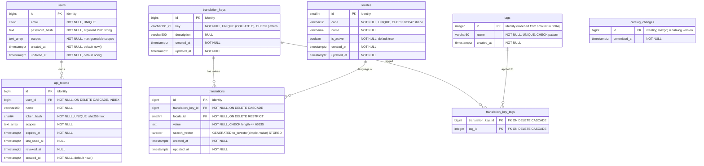
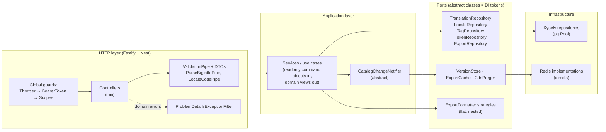

# ADR 0001: Translation Management Service architecture

- **Status:** Accepted
- **Scope:** data model, API surface, export freshness and caching, layering, risks

## 1. Data model

**Indexes**

| Table                  | Index                                      | Serves                                                                                   |
| ---------------------- | ------------------------------------------ | ---------------------------------------------------------------------------------------- |
| `translation_keys`     | `UNIQUE (key)` with column collation `"C"` | Uniqueness, `key LIKE 'prefix%'` range scans, and bytewise `ORDER BY key` for the export |
| `translations`         | `UNIQUE (translation_key_id, locale_id)`   | Upsert conflict target, and batched value loading by `translation_key_id = ANY($1)`      |
| `translations`         | `(locale_id, translation_key_id)`          | Export scan for one locale, and the locale-filtered search                               |
| `translations`         | `GIN (search_vector)`                      | Word search: `@@ websearch_to_tsquery`                                                   |
| `translations`         | `GIN (value gin_trgm_ops)`                 | Substring search: `ILIKE '%term%'`                                                       |
| `translation_key_tags` | `PRIMARY KEY (translation_key_id, tag_id)` | Loading tags for a page of keys                                                          |
| `translation_key_tags` | `(tag_id, translation_key_id)`             | Tag filters (`EXISTS`, `GROUP BY … HAVING`)                                              |
| `api_tokens`           | `UNIQUE (token_hash)`                      | Token lookup on every request                                                            |
| `api_tokens`           | `(user_id)`                                | Foreign-key cascades                                                                     |

`updated_at` is maintained by a `BEFORE UPDATE` trigger, so no code path can forget it.

### Deviations from the baseline schema (with reasons)

1. **`INCLUDE (value)` dropped from the export index.**
   - A B-tree tuple is capped at about 2,704 bytes (one third of a page), but values may be up to 65,535 characters.
   - Inserting a long value would therefore fail with `index row size exceeds btree maximum`, a correctness bug and not just a size problem.
   - The plain `(locale_id, translation_key_id)` index still narrows the export to one locale; the heap fetch for about 50k rows is cheap and stays in shared buffers.
   - The cold export is measured in Phase 3 to prove this.
2. **`translation_keys.key` uses `COLLATE "C"` instead of a second `varchar_pattern_ops` index.**
   - Keys are restricted to `[a-z0-9._-]`, so bytewise ordering is the correct semantics anyway.
   - Under the C collation, the unique B-tree supports `LIKE 'prefix%'` range scans and the export's `ORDER BY key` directly.
   - That leaves one index instead of two, with less write amplification and the same plans (verified with `EXPLAIN`).
3. **`users.scopes text[]` added.** A user can only mint tokens whose scopes are a subset of their own (least privilege). This needs a per-user ceiling.
4. **`CHECK` constraints** on key, tag and locale-code shapes and on value length give defence in depth behind DTO validation.
5. **`created_at` added to `api_tokens` and `tags`, and `updated_at` to `users`**, for auditability.
6. **`catalog_changes` added (migration 0003).** An append-only log whose `max(id)` is the authoritative catalog version (see §3). Append-only avoids one hot row that would serialise every writer; old rows are pruned.
7. **Tag ids widened to `integer` (migration 0004).** `INSERT … ON CONFLICT DO NOTHING` consumes a sequence value even when the row exists, so tagging writes exhausted the 32,767 `smallint` ids and every tagged POST failed. `TagRepository.ensure` now inserts only names that do not exist (`WHERE NOT EXISTS`), and the column is widened as a second line of defence. A regression test covers it.

### Modelling rationale

- **Tags attach to keys, not to locale values.** "mobile" describes the string's purpose, not its French text.
- **Locales are rows.** Adding a language is an `INSERT` through `POST /locales`. There is no migration and no deploy.
- **The aggregate root is the translation key** together with its per-locale values and its tags. All writes go through the key.
- **The `simple` text-search configuration** is language-agnostic. One stemmer cannot serve en, fr, es and zh at once.

## 2. Endpoints

All paths are prefixed with `/api/v1`. Success responses use `{ data, meta? }`. Errors use `application/problem+json`. Bigint ids are serialized as strings.

| Method | Path                 | Scope                                                               | Request                                                                           | Response                                                | Status codes                 |
| ------ | -------------------- | ------------------------------------------------------------------- | --------------------------------------------------------------------------------- | ------------------------------------------------------- | ---------------------------- |
| POST   | /auth/tokens         | public, throttle `auth` (5/min per IP+email)                        | `CreateTokenDto {email, password, name, scopes?, ttlSeconds?}`                    | `IssuedTokenResponse`                                   | 201, 401, 422, 429           |
| DELETE | /auth/tokens/current | any valid token                                                     | none                                                                              | none                                                    | 204, 401                     |
| GET    | /locales             | translations:read                                                   | none                                                                              | `LocaleResponse[]`                                      | 200, 401, 403                |
| POST   | /locales             | locales:write                                                       | `CreateLocaleDto {code, name, isActive?}`                                         | `LocaleResponse` + `Location`                           | 201, 401, 403, 409, 422      |
| PATCH  | /locales/:code       | locales:write                                                       | `UpdateLocaleDto {name?, isActive?}`                                              | `LocaleResponse`                                        | 200, 401, 403, 404, 422      |
| GET    | /tags                | translations:read                                                   | none                                                                              | `TagResponse[]`                                         | 200, 401, 403                |
| GET    | /translations        | translations:read                                                   | `ListTranslationsQueryDto {key?, q?, tags?, tagsMode?, locale?, cursor?, limit?}` | `TranslationKeyResponse[]` + `meta {nextCursor, limit}` | 200, 401, 403, 422           |
| POST   | /translations        | translations:write                                                  | `CreateTranslationDto {key, description?, values, tags?}`                         | `TranslationKeyResponse` + `Location`                   | 201, 401, 403, 409, 422      |
| GET    | /translations/:id    | translations:read                                                   | none                                                                              | `TranslationKeyResponse`                                | 200, 401, 403, 404, 422      |
| PATCH  | /translations/:id    | translations:write                                                  | `UpdateTranslationDto {description?, values?, tags?}`                             | `TranslationKeyResponse`                                | 200, 401, 403, 404, 422      |
| DELETE | /translations/:id    | translations:write                                                  | none                                                                              | none                                                    | 204, 401, 403, 404, 422      |
| GET    | /export/:locale      | export:read, or public when `EXPORT_PUBLIC=true`; throttle `export` | `ExportQueryDto {tags?, tagsMode?, format?}`                                      | raw JSON document (no envelope)                         | 200, 304, 401, 403, 404, 422 |
| GET    | /health              | public                                                              | none                                                                              | terminus result                                         | 200, 503                     |
| GET    | /health/live         | public                                                              | none                                                                              | `{status:'ok'}`                                         | 200                          |

Every authenticated endpoint can also return 429. Every body-accepting endpoint can return 413 and 415. Every endpoint can return 500.

- **Key immutability:** `PATCH /translations/:id` does not accept `key`. Renaming is a delete plus a create; immutable keys keep frontend references and CDN caches stable.
- **Tag semantics:** `tags` on PATCH **replaces** the key's tag set.
- **Value semantics:** `values` on PATCH **merges** by locale using an upsert.

## 3. Export freshness and caching

The goal is to serve the export in under 500 ms cold and never serve stale data after a write.

1. **Write path.** Each mutating use case runs inside `CatalogTransaction.run(trx => …)`.
   - Inside the transaction it inserts a `catalog_changes` row. **Postgres is the source of truth for the version**: a rollback leaves no row, a commit always advances `max(id)`.
   - After the commit it awaits `CatalogChangeNotifier.notifyChanged(version)`, which publishes the new version to Redis with a set-if-greater Lua script (bounded retries), so the Redis value only ever moves forward. Only then does the HTTP response return.
   - After the publish, the CDN purger and the optional cache warmer run in the background through a debounced `latestOnly` runner (a burst of writes triggers one purge and one warm, for the latest version). Errors are caught and logged.
   - **Self-healing:** `VersionReconciler` re-publishes `max(id)` every `CATALOG_RECONCILE_INTERVAL_MS`. A publish that failed after a commit is therefore stale for at most one interval, not for a cache TTL. A Redis value _ahead_ of Postgres (restore, corruption, old key layout) would freeze exports under monotonic publishing; the reconciler repairs it with compare-and-set so a racing legitimate publish is never overwritten.
2. **Read path** (`GET /export/:locale`):
   1. `GET catalog:version` from Redis. This is one round trip.
   2. Resolve the locale and tag ids from the in-memory `CatalogCache`. The cache is keyed by catalog version, so a version change forces a reload. This keeps locale deactivation fresh across instances.
   3. Build the cache key `export:{locale}:{format}:{tagsMode}:{sha1(sorted tags)}:v{version}` and the weak ETag `W/"sha1(cacheKey)"`.
   4. If `If-None-Match` matches, return **304**. Postgres was never touched and the payload was never read.
   5. Otherwise `GET` the gzip buffer from Redis. On a hit, send it as-is with `Content-Encoding: gzip`, or gunzip it for clients that do not accept gzip.
   6. On a miss, run a **coalesced cold build**:
      - An in-process `SingleFlight<cacheKey, Buffer>` collapses concurrent requests on this instance.
      - `SET lock:{cacheKey} NX PX 10000` elects one builder across instances. The others poll the cache key for at most `EXPORT_LOCK_WAIT_MS`, then build on their own, so a dead lock holder costs one duplicate build rather than a blocked request.
      - The build is one SQL query (`translations ⋈ translation_keys WHERE locale_id = $1 [tag filter] ORDER BY key`), then the formatter strategy (rendered cooperatively in chunks so other requests keep being served), then gzip level 4.
      - The result is stored with `SET … PX ttl` and returned.
3. **Why this is always fresh.**
   - The version is part of both the cache key and the ETag. A post-commit bump makes every older entry unreachable. Nothing is deleted, so there is no delete-versus-rebuild race.
   - A request that read the old version just before a bump may still receive the old document. That request started before the write was acknowledged, which is linearizable behaviour.
4. **Headers.**
   - Always: `ETag`, `Vary: Accept-Encoding, Authorization`, and `Content-Type: application/json; charset=utf-8`.
   - When `EXPORT_PUBLIC=true`: `Cache-Control: public, max-age=0, s-maxage=60, stale-while-revalidate=30, must-revalidate`.
   - Otherwise: `Cache-Control: private, no-cache`.
5. **CDN support.**
   - `CdnPurger` is an interface. `NullCdnPurger` is the default, and an `HttpCdnPurger` (Cloudflare or Fastly style, URL plus token from config) fires after a version bump.
   - In public mode the CDN revalidates with the ETag, and the s-maxage window bounds edge staleness when no purger is configured. The README documents this trade-off.

## 4. Modules and layering

- **Single responsibility:**
  - Controllers map DTOs to commands and views to response DTOs.
  - Services hold the use-case rules and transaction boundaries.
  - Repositories hold SQL only.
  - Formatters are pure functions over rows.
- **Open/closed and Liskov:**
  - Formatters register in a `Map<ExportFormat, ExportFormatter>` built from a multi-provider token.
  - Adding YAML means adding a class and one provider entry. No existing class changes.
- **Interface segregation:** each port is small. Reads and writes are separate methods on narrow interfaces. Export reads have their own `ExportRepository` and do not reuse the CRUD repository.
- **Dependency inversion:** services inject abstract classes, wired as `{ provide: TranslationRepository, useClass: KyselyTranslationRepository }`.
- **Transactions:** services open the transaction and pass a `DbExecutor` (`Kysely<DB> | Transaction<DB>`) into repository methods.

## 5. Risks and mitigations

| Risk                                                                                | Mitigation                                                                                                                                                                                                                                                                  |
| ----------------------------------------------------------------------------------- | --------------------------------------------------------------------------------------------------------------------------------------------------------------------------------------------------------------------------------------------------------------------------- |
| Covering index with `INCLUDE (value)` breaks inserts of long values                 | Dropped (see the deviations above); cold export latency measured instead                                                                                                                                                                                                    |
| Redis publish fails after the database commit, leaving the export stale             | The version lives in Postgres (`catalog_changes`); bounded retry on publish; `VersionReconciler` republishes every interval, so staleness is bounded by `CATALOG_RECONCILE_INTERVAL_MS`; failures are logged                                                                |
| Redis version ahead of Postgres freezes exports                                     | Reconciler detects `cached > latest` and repairs with compare-and-set; e2e tested                                                                                                                                                                                           |
| Rate-limit bypass with random bearer tokens (each invalid token got its own bucket) | A per-IP auth-failure limiter returns 429 after `THROTTLE_AUTH_FAILURE_LIMIT` bad tokens a minute (checked before the token lookup); the `api` / `export` throttles run _after_ authentication, keyed by the verified token id, so random strings cannot mint fresh budgets |
| Search with no or rare matches scans the whole key range                            | Adaptive plan: probe a 2,000-id window with per-key `EXISTS`; if the page is not filled, switch to set predicates driven by the GIN / tag indexes (`MATERIALIZED` CTE)                                                                                                      |
| Cache stampede on a hot cold-key after a bump                                       | In-process promise coalescing plus a Redis `SET NX PX` lock, then poll, then fallback                                                                                                                                                                                       |
| Trigram index cannot help 2-character substrings                                    | Substring `ILIKE` fallback only for terms of 3 or more characters; 2-character terms use word matching only                                                                                                                                                                 |
| Keyset plans with filters could fall back to sequential scans                       | `EXPLAIN (ANALYZE, BUFFERS)` on every hot query at 200k rows, recorded in the README                                                                                                                                                                                        |
| N+1 when hydrating pages                                                            | One statement per page: the page of keys is selected with `LIMIT`, and values and tags are aggregated per key with correlated `json_object_agg` / `json_agg`; asserted by a query-counting Kysely plugin in e2e                                                             |
| Token lookup on every request adds latency                                          | Unique-index point lookup, plus a 5 s in-process cache of verified tokens (`AUTH_TOKEN_CACHE_MS`; revocation on the same instance is immediate, on other instances within that window); `last_used_at` written at most once per minute per token                            |
| Credential stuffing and user enumeration                                            | 5/min per IP+email throttle; argon2id; a dummy hash is verified for unknown emails so timing is equal; one generic 401 message                                                                                                                                              |
| Prototype pollution through `values` keys or nested export keys                     | Fastify's secure JSON parser rejects `__proto__`; locale keys are checked against a `Map`; the nested formatter builds `Object.create(null)` nodes                                                                                                                          |
| Nested key collisions (`a.b` and `a.b.c`)                                           | Deterministic, order-independent rule: a leaf always owns its path, and a deeper key that would pass through a leaf is emitted as a literal dotted key in the deepest reachable object (`{a:{b:"x","b.c":"y"}}`). Unit tested                                               |
| Cross-instance locale cache staleness                                               | The export path keys `CatalogCache` by the Redis catalog version; validation reloads on a miss                                                                                                                                                                              |
| Leaking internals in errors                                                         | One global filter; generic 404 and 500 bodies; stack traces never sent; pg errors mapped by SQLSTATE only                                                                                                                                                                   |
| Mass assignment                                                                     | Whitelisted DTOs with `forbidNonWhitelisted` (422); explicit response DTOs, never raw rows                                                                                                                                                                                  |
